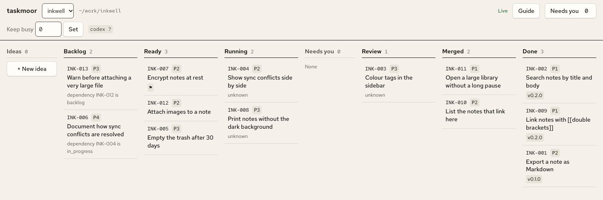
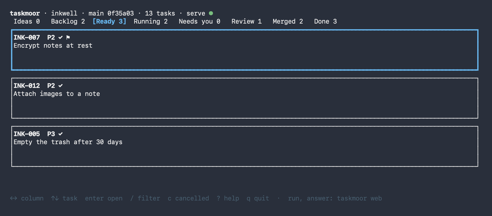

# taskmoor

[](https://github.com/proshik/taskmoor/actions/workflows/ci.yml)

Tasks that live in the repository, and a conveyor that runs coding agents
on them.

<picture>
  <source media="(prefers-color-scheme: dark)" srcset="docs/images/board-dark.png">
  
</picture>

- **The format.** Each task is a file, `tasks/<ID>-<slug>.md` (YAML front
  matter + Markdown body), with `tasks/tasks.toml` for the project. The
  lifecycle (backlog, in progress, review, merged, done) is derived from
  git and a small shared state file, so every worktree sees the same board.
  The format is specified in [`spec/README.md`](spec/README.md) with JSON
  schemas (`format = 1`), embedded in the binary.
- **The CLI and the TUI board.** `taskmoor list | show | ready | validate
  | claim | review | release` and a terminal board, for people and for
  agents (see [`skills/taskmoor/SKILL.md`](skills/taskmoor/SKILL.md)).
- **The service.** `taskmoor serve` runs agent sessions on ready tasks —
  Claude Code, Codex and OpenCode, on your own sign-ins and subscriptions —
  each in its own worktree and branch (Claude's and Codex's in their
  sandboxes). Their questions and
  approvals come to a web board (and Telegram, and the phone), a
  dispatcher answers what the project's documents already answer, the
  finished branch goes through code review, and you accept it into main.
  Push stays yours.

The service and the agents run on your Mac, under your sign-ins: nothing
of taskmoor runs anywhere else. How to use the service is in
[`docs/service.md`](docs/service.md); the design and its history are in
[`docs/plan.md`](docs/plan.md) (the format and the CLI) and
[`docs/conveyor.md`](docs/conveyor.md) (the service, stage by stage).

## Install

Needs git 2.45 or newer on `PATH` (taskmoor checks it: older git fetches
missing objects of a partial clone despite `GIT_NO_LAZY_FETCH`, and lacks
`worktree list -z` before 2.36). macOS and Linux; the service is built and
checked on macOS (idle-sleep assertion, the plan usage readers, launchd).

From a release (macOS and Linux, arm64 and amd64):

```sh
v=v0.1.0 os=darwin arch=arm64            # your version and system (linux, amd64)
curl -fsSLO https://github.com/proshik/taskmoor/releases/download/$v/taskmoor_${v}_${os}_${arch}.tar.gz
curl -fsSLO https://github.com/proshik/taskmoor/releases/download/$v/checksums.txt
grep "taskmoor_${v}_${os}_${arch}.tar.gz" checksums.txt | shasum -a 256 -c
tar -xzf taskmoor_${v}_${os}_${arch}.tar.gz
install taskmoor_${v}_${os}_${arch}/taskmoor ~/.local/bin/   # or anywhere on PATH
taskmoor version
```

The binaries are not signed: an archive downloaded with a browser on macOS
needs `xattr -d com.apple.quarantine taskmoor` once (curl does not mark it).

With Go 1.26:

```sh
go install github.com/proshik/taskmoor/cmd/taskmoor@latest
```

From a checkout ([`just`](https://github.com/casey/just) for the recipes):

```sh
just build          # bin/taskmoor
just check          # gofmt, go vet, golangci-lint (when installed), go test
```

## Quick start

In a repository with `tasks/` (the format's example config is
[`spec/tasks.example.toml`](spec/tasks.example.toml)):

```sh
taskmoor validate                       # the tasks check out
taskmoor                                # the TUI board
```

To run agents, sign in to [Claude Code](https://code.claude.com) with your
subscription (`claude`, then `/login`) and write
`~/.config/taskmoor/config.toml`:

```toml
default_profile = "claude"

[[profiles]]
name = "claude"
harness = "claude"
```

More profiles (Codex, OpenCode, another model) and the dispatcher are in
[Configuration](docs/service.md#configuration). Then:

```sh
taskmoor serve                          # in its own terminal tab; prints the board's sign-in link
taskmoor project add ~/work/some-project
```

and press **Run** on a ready task in the board (or `taskmoor run ID`).

## A task through the conveyor

1. **Run.** The service makes a worktree beside the repository on a branch
   `task/<ID>-<slug>`, claims the task and starts the agent of its routed
   [profile](docs/service.md#profiles-and-routing) (a Claude profile in
   [Claude's sandbox](docs/service.md#claudes-sandbox-stage-2b)).
2. **Follow.** The card's feed shows what the agent does; **Say** sends it
   an instruction, **Stop** stops it (the claim, worktree and branch stay).
3. **Needs you.** Questions and approvals the
   [dispatcher](docs/service.md#the-dispatcher-stage-4) does not settle
   wait in Needs you, in [Telegram](docs/service.md#telegram-stage-7) and
   on [the phone](docs/service.md#the-web-from-outside-stage-9-v2).
   Approvals are never the dispatcher's.
4. **Review.** When the agent finishes, the task moves to Review and gets
   [code-review rounds](docs/service.md#review-and-acceptance-stage-5);
   their findings go back to the same session.
5. **Accept.** The acceptance view shows the commits, the diff, the task's
   Checks, the agent's summary and the review; **Accept** merges the
   branch into your local main with `Task: <ID>`. Push stays yours.
6. **Clean up.** [`taskmoor cleanup`](docs/service.md#cleaning-up-stage-12)
   moves the worktrees of merged work to the repository's trash and
   deletes their branches.

The same from the CLI:

```sh
taskmoor ready
taskmoor run PRJ-007                    # worktree ../some-project-prj-007, branch task/PRJ-007-<slug>, claim, start Claude
taskmoor feed PRJ-007 --follow          # what the agent does
taskmoor inbox                          # its questions and approvals
taskmoor answer <ask> 1                 # pick an option (* marks the recommended one)
taskmoor say PRJ-007 "also update the README"
taskmoor acceptance PRJ-007             # the work to accept
taskmoor accept PRJ-007 --tip C         # C from the acceptance view
```

## Use

```
taskmoor [--repo PATH] [--source main|worktree]      the TUI board
taskmoor list     [--json]                           every task with its status
taskmoor show ID  [--json]                           front matter, status, reasons, state, body
taskmoor ready    [--json]                           takeable tasks, priority then id
taskmoor validate [--json]                           all checks; exit 1 on any error
taskmoor claim ID --branch B --worktree W [--harness H] [--session S] [--person] [--force]
taskmoor review ID
taskmoor release ID
taskmoor version
```

`taskmoor help` lists these and the service's commands.

- The board, `list`, `show`, `ready` and `claim` read the tasks from the
  **main branch's tree**, so they look the same from every worktree.
  `validate` reads the **working tree** (what is about to be committed).
  `--source` overrides either.
- Exit codes: `0` ok; `1` validation errors or a refused transition; `2` a
  usage error or a project that cannot be read.
- Inside Guild (`GUILD_SOCKET` set, `guild` on `PATH`) the harness status
  comes from `guild agent list --json`; elsewhere from the state file.

### The board



Columns Backlog, In progress, Review, Merged, Done (`c` adds Cancelled);
with the service running and the project registered, the conveyor's
columns instead.
`←→`/`hl` column, `↑↓`/`jk` task, `enter` detail, `/` filter, `r` ready
only, `R` refresh, `?` help, `q` quit. It polls every 2 s and reloads when
the main branch, the tags or the state files change.

### Lifecycle

| Lifecycle | From |
| --- | --- |
| `cancelled` | the task file on main says so |
| `done` | a release tag of the task's component contains its merge commit |
| `merged` | a first-parent commit on main carries `Task: <ID>` |
| `in_progress`, `review` | the shared state file `<git-common-dir>/tasks/state/<ID>.json` |
| `backlog` | otherwise |

`claim` writes the state file (atomic create-if-absent, under a per-project
`flock` on `<state>/.lock`), `review` rewrites it, `release` removes it (for
a stale file the lifecycle stays what git or the main branch says). The
three always read the main branch, whatever `--source` says. If the change
is published but syncing the state directory fails, the command still exits
0 and warns that the change may not survive a crash: other readers already
see it, so check the state (`taskmoor show ID`) rather than repeating it.

Readers never write: git runs with `GIT_NO_LAZY_FETCH=1` and
`GIT_OPTIONAL_LOCKS=0`, task files over 1 MiB (64 MiB together) and state
files over 64 KiB are refused, and only regular files are read.

## Documentation

- [`docs/service.md`](docs/service.md) — the service: configuration, the
  web board, profiles and routing, the dispatcher, review and acceptance,
  the agents' rules, sandbox and billing, usage, Telegram, ideas, the
  phone, cleaning up.
- [`spec/README.md`](spec/README.md) — the task format.
- [`skills/taskmoor/SKILL.md`](skills/taskmoor/SKILL.md) — how an agent
  uses taskmoor.
- [`docs/plan.md`](docs/plan.md) and [`docs/conveyor.md`](docs/conveyor.md)
  — the design and every decision taken, stage by stage.
- [`AGENTS.md`](AGENTS.md) — how to work in this repository: the package
  layout, checks, tests, releases.

## Development

`just check` runs what CI runs on every push and pull request (gofmt,
`go vet`, `go test -race` on Linux and macOS). The tests drive real git
repositories and fake agents; no test reaches a real agent or the network.
How to work in this repository: [`AGENTS.md`](AGENTS.md).

## License

[MIT](LICENSE)
